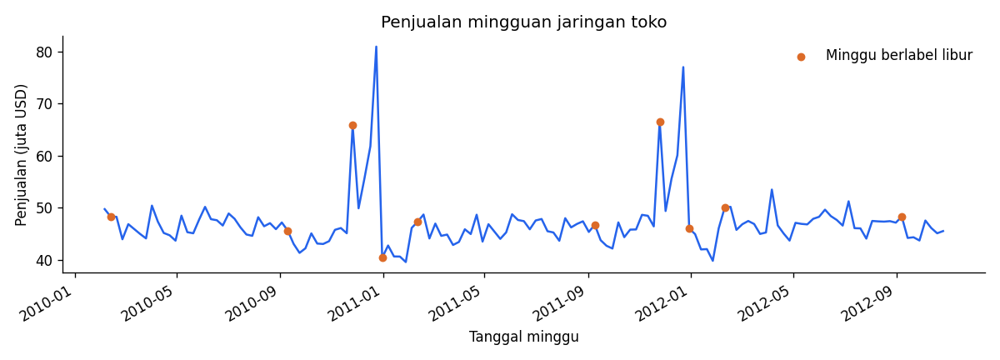

# Analisis Dataset Walmart

Analisis penjualan mingguan 45 toko untuk menentukan periode persiapan kapasitas dan prioritas pemeriksaan toko. Proses utama dikerjakan dalam Jupyter Notebook dengan penjelasan berbahasa Indonesia.



## Buka hasil proyek

- [Notebook di Google Colab](https://colab.research.google.com/drive/1MtU4msonzBqRCB_1MaiDwv3eJ9Vk0NpL)
- [Dashboard Google Sheets](https://docs.google.com/spreadsheets/d/1bcIDtRnMCotxuGRRCP31Cyo-Fu1aX4mAwmlVx1b6W2M/edit)
- [Laporan Google Docs](https://docs.google.com/document/d/1k1ymVVeFtOVYi7j58q1Gu9uW4wmD4kSNu4aPtlOLc00/edit)
- [Laporan Word](docs/Laporan_Analisis_Penjualan_Walmart.docx)

Tautan Google mengikuti izin akun pemilik. Berkas tidak dibuka untuk publik secara otomatis. Untuk portofolio publik, atur sendiri izin baca berkas yang memang ingin dibagikan.

## Masalah bisnis

Manajer perlu mengetahui kapan penjualan meningkat, toko mana yang perlu diperiksa, serta apakah perbandingan bulanan dan tahunan sudah menggunakan periode setara. Analisis menjawab:

1. Kapan laju penjualan mingguan tinggi?
2. Toko mana yang berkontribusi besar dan mengalami penurunan?
3. Bagaimana penjualan pada minggu berlabel libur dibanding minggu lainnya?
4. Apakah hubungan faktor ekonomi tetap terlihat setelah perbedaan skala toko dikurangi?

## Dataset dan batas analisis

Sumber: [Walmart Sales oleh mikhail1681 di Kaggle](https://www.kaggle.com/datasets/mikhail1681/walmart-sales).

| Cakupan | Nilai |
| --- | ---: |
| Baris toko per minggu | 6.435 |
| Toko | 45 |
| Tanggal minggu | 143 |
| Mulai | 5 Februari 2010 |
| Akhir | 26 Oktober 2012 |
| Kolom sumber | 8 |

Satu baris merupakan satu toko pada satu tanggal minggu. Weekly_Sales diperlakukan sebagai penjualan USD sesuai konteks sumber. Data tidak memuat biaya, barang, pelanggan, stok, luas, dan lokasi toko. Karena itu, analisis tidak menghitung laba atau efisiensi per luas toko. Temuan merupakan hasil analisis baru atas data historis, bukan kondisi Walmart pada 2026.

Sidik jari berkas ada pada [provenance.json](outputs/reports/provenance.json). CSV eksekusi ini diunduh dari endpoint resmi Kaggle; KaggleHub belum tersedia pada lingkungan pengujian lokal. Notebook menyediakan unduhan KaggleHub untuk Colab. Versi Kaggle numerik tidak tercatat; snapshot dikenali melalui SHA256. Mengambil versi terbaru di kemudian hari dapat mengubah hasil.

## Metode dan alasan penggunaannya

| Tahap | Pengerjaan | Tujuan |
| --- | --- | --- |
| Rumusan masalah | Tentukan waktu persiapan dan toko prioritas | Menjaga analisis terhubung dengan keputusan |
| Audit data | Cek kosong, duplikat, angka, kunci, kalender lengkap | Mencegah salah total atau minggu hilang |
| Pembersihan | Parse tanggal `%d-%m-%Y`, standardisasi numerik | Menjaga urutan waktu dan perhitungan benar |
| Pola waktu | Total bulan dan rata-rata per minggu | Memisahkan laju penjualan dari jumlah minggu |
| Perbandingan toko | Pasangkan minggu ISO pada 2011 dan 2012 | Menghindari perbandingan tahun parsial |
| Libur | Bandingkan rata-rata per tanggal minggu, cek per tahun | Memperhatikan jumlah minggu yang berbeda |
| Ekonomi | Korelasi gabungan dan setelah rata-rata toko dikurangi | Memeriksa pengaruh perbedaan skala tetap toko |
| Penyampaian | Notebook, laporan, Sheets | Memudahkan pemeriksaan dan pengulangan |

Tidak ditemukan nilai kosong, duplikat, atau minggu toko yang hilang. Lonjakan penjualan dipertahankan. Bulan mengikuti tanggal minggu; penjualan tidak dibagi ke hari karena detail harian tidak ada.

## Hasil utama

| Ukuran | Hasil |
| --- | ---: |
| Total penjualan | USD 6.737.218.987,11 |
| Rata-rata jaringan per minggu | USD 47.113.419,49 |
| Pertumbuhan 2012 terhadap 2011 pada 43 minggu sebanding | 2,57% |
| Toko yang turun pada periode sebanding | 8 |
| Kontribusi lima toko terbesar | 21,55% |
| Minggu tertinggi | 24 Desember 2010, USD 80,93 juta |

Perbandingan tahunan memasangkan 7 Januari–28 Oktober 2011 dengan 6 Januari–26 Oktober 2012 berdasarkan minggu ISO. Tanggal kalender tidak persis sama. Toko 14 turun USD 7,25 juta (8,56%); Toko 36 turun USD 2,82 juta (17,50%). Toko 20 menjadi penyumbang terbesar pada seluruh periode, USD 301,40 juta.

### Temuan tambahan tentang September

| Bulan | Total USD | Minggu | Rata-rata mingguan USD |
| --- | ---: | ---: | ---: |
| September 2011 | 220.847.738,42 | 5 | 44.169.547,68 |
| September 2012 | 180.645.544,47 | 4 | 45.161.386,12 |

Total turun 18,20%, sedangkan rata-rata mingguan naik 2,25%. Jumlah minggu dapat mengubah arah kesimpulan. Hindari mengurangi kapasitas hanya dari total bulanan yang lebih rendah.

Sepuluh minggu berlabel libur memiliki rata-rata jaringan USD 50,53 juta, dibanding USD 46,86 juta pada 133 minggu lainnya. Selisih 7,84% adalah hubungan deskriptif. Minggu tertinggi justru tidak berlabel libur. Setelah satu minggu tertinggi dikeluarkan, selisih menjadi 8,44%. Label libur perlu dibaca bersama kalender. Korelasi linear faktor ekonomi lemah, baik sebelum maupun sesudah pengurangan rata-rata toko; hasilnya belum membuktikan sebab.

## Rekomendasi

- Tinjau kesiapan stok dan tenaga kerja sebelum periode ramai akhir tahun. Data ini belum menentukan jumlah tambahan stok atau tenaga kerja.
- Periksa Toko 14 untuk penurunan nominal dan Toko 36 untuk penurunan persentase. Cocokkan dengan stok kosong, jam buka, promosi, dan kejadian lokal.
- Laporkan total bersama jumlah minggu dan rata-rata mingguan. Bandingkan tahun pada minggu yang sama.
- Tambahkan data stok, biaya, ukuran, lokasi, dan promosi sebelum menilai efisiensi atau penyebab perubahan.

## Menjalankan notebook

1. Buka tautan Colab di atas, atau unggah `notebooks/01_walmart_sales_analysis.ipynb` melalui File → Upload notebook.
2. Di Colab, jalankan instalasi pada bagian 1 dengan menghapus tanda komentar pada baris `%pip` jika paket belum tersedia.
3. Jalankan bagian 1–9 secara berurutan. KaggleHub mengambil data jika CSV belum ada. Jika Kaggle meminta akses, login pada akun Kaggle sendiri; jangan simpan token dalam repository.
4. Periksa tabel audit, grafik, dan angka rekonsiliasi. Notebook menghasilkan CSV dan PNG di folder keluaran.
5. Untuk sinkronisasi Google Sheets, jalankan bagian 10 dengan `RUN_GOOGLE_SYNC = True`. URL Sheets sudah diisi. Login menggunakan akun dengan akses edit.

Untuk Jupyter lokal: buat lingkungan Python, jalankan `pip install -r requirements.txt`, lalu buka notebook melalui Jupyter atau VS Code. Jupyter/VS Code adalah alat pembuka dan dipasang terpisah.

Notebook tersimpan mempunyai keluaran eksekusi analisis Python yang sebenarnya. Sel instalasi dan autentikasi Google belum dijalankan. Pengujian memakai eksekusi sel Python berurutan, bukan kernel Colab. Hasil instalasi KaggleHub dan autentikasi Colab tetap perlu diuji pada akun pengguna.

## Dashboard dan integrasi Google

Pada tab Dashboard, ubah **B3** untuk tahun, **E3** untuk bulan 1–12, dan **H3** untuk toko. Ringkasan mengikuti ketiganya. Grafik tahunan mengikuti tahun dan toko. Pilihan bulan tidak memotong grafik tahunan.

Sheets sudah berisi hasil analisis dan dapat digunakan tanpa menjalankan Colab. Sel sinkronisasi mengganti Weekly_Data, bukan menambahkan baris, agar tidak terjadi duplikasi. Formula dashboard mengacu sampai baris 6436 dan daftar 45 toko sesuai dataset ini. Jika cakupan sumber bertambah, perluas rentang formula dan daftar toko sebelum memakai dashboard. Pembaruan tidak terjadwal otomatis.

Layanan dashboard Google yang dapat membaca Sheets adalah **Looker Studio**. [Panduan lengkap](docs/google_workflow.md) mencakup tipe tanggal, rumus, filter, dan angka uji. Dashboard Looker Studio terpisah belum dibuat; tampilan interaktif yang sudah tersedia adalah Google Sheets.

## Struktur proyek

```text
walmart-sales-analysis/
├── notebooks/01_walmart_sales_analysis.ipynb
├── data/README.md
├── docs/
│   ├── Laporan_Analisis_Penjualan_Walmart.docx
│   ├── google_workflow.md
│   ├── data_dictionary.md
│   └── verification.md
├── outputs/
│   ├── figures/
│   └── reports/
├── requirements.txt
└── README.md
```

CSV mentah, detail hasil olahan, dan pasangan catatan toko-minggu dibangun ulang oleh notebook dan tidak disertakan dalam paket. Periksa ketentuan Kaggle sebelum redistribusi data. [Catatan validasi](docs/verification.md) memisahkan pengujian yang sudah dilakukan dari integrasi yang belum diuji.

## Repository

Proyek: https://github.com/Darren0099/Analisis-Dataset-Walmart

Unduh atau clone repository ini, lalu buka notebook utama pada folder notebooks. CSV mentah dan detail olahan dibangun ulang melalui notebook.
